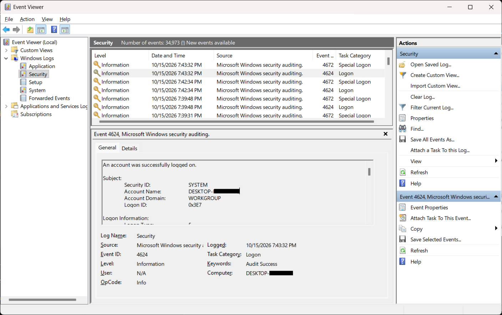
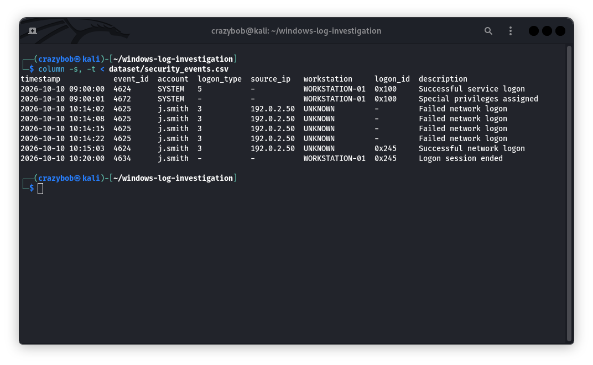
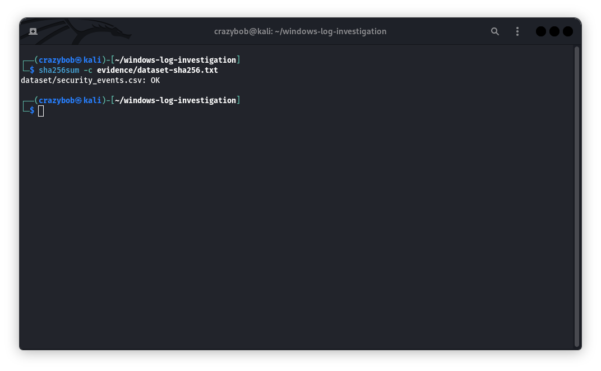

# Windows Security Log Analysis and Incident Investigation

## Project Overview

This beginner cybersecurity project demonstrates how Windows Security events can be analysed to identify potentially suspicious login activity. It uses a fictional dataset, an investigation timeline, and a written report.

**Important:** All events in the CSV dataset are synthetic training data. They were not collected from a real Windows computer.

## Objectives

- Understand common Windows Security Event IDs.
- Identify repeated failed login attempts.
- Correlate failed attempts with a subsequent successful login.
- Build an investigation timeline.
- Document findings and recommendations.
- Verify dataset integrity using SHA-256 checksums.

## Tools and Technologies

- Windows 11 Event Viewer
- Kali Linux
- Linux command-line utilities
- CSV files
- SHA-256
- Git and GitHub

## Event IDs Reviewed

| Event ID | Meaning |
|---|---|
| 4624 | Successful logon |
| 4625 | Failed logon |
| 4634 | Logon session ended |
| 4672 | Special privileges assigned |

## Investigation Summary

The synthetic dataset contains four failed network logon attempts for the same account and sample source IP address within approximately 20 seconds. A successful network logon for the same account and source IP follows 41 seconds after the last recorded failure.

Repeated authentication failures followed by a successful logon may indicate password guessing or another authentication issue. However, these events alone do not prove that an account was compromised.

**Initial classification:** Potentially suspicious — further investigation required.

The IP address `192.0.2.50` is reserved for documentation and examples.

## Repository Structure

- `dataset/security_events.csv` — fictional Windows Security events.
- `evidence/dataset-sha256.txt` — dataset checksum manifest.
- `reports/incident-investigation-report.md` — investigation findings and limitations.
- `screenshots/` — project screenshots, if added.

## How to Review the Dataset

Display the events in aligned columns:

```bash
column -s, -t < dataset/security_events.csv
```

Count the CSV lines:

```bash
wc -l dataset/security_events.csv
```

Verify the dataset checksum:

```bash
sha256sum -c evidence/dataset-sha256.txt
```

## Project Screenshots

### Windows Event Viewer

This screenshot shows an example of reviewing a Windows Security log event. Any real-system identifiers have been removed before publication.



### Synthetic Security Log Analysis

The following screenshot demonstrates reviewing the fictional CSV dataset in Kali Linux.



### SHA-256 Integrity Verification

This screenshot shows the successful checksum verification of the synthetic dataset.



## Limitations

- The dataset is fictional and contains only a small number of events.
- It does not contain every field available in native Windows Security logs.
- The exercise does not establish a real security incident.
- A real investigation would require additional evidence and context.

## Learning Outcomes

This project demonstrates basic Windows log analysis, authentication event correlation, timeline construction, evidence integrity verification, and incident reporting.

## Disclaimer

This is an educational project using synthetic data. It does not identify or accuse any real person, device, or organisation.
